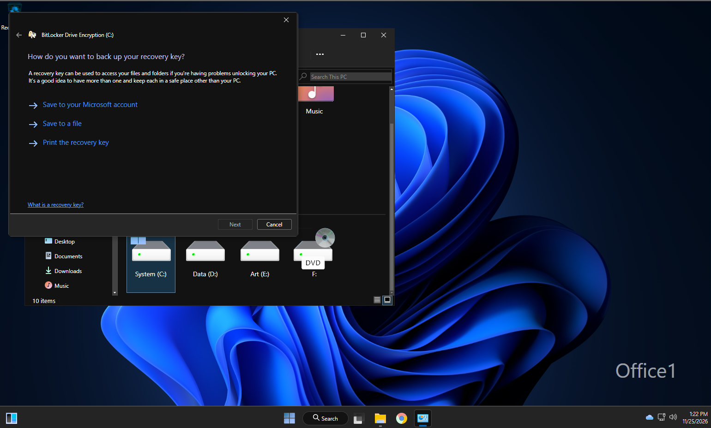
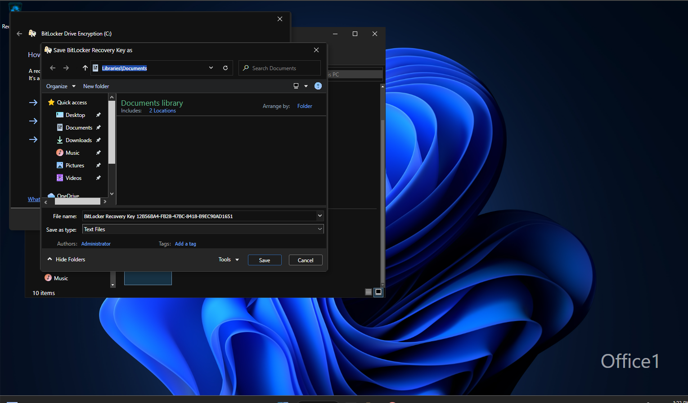
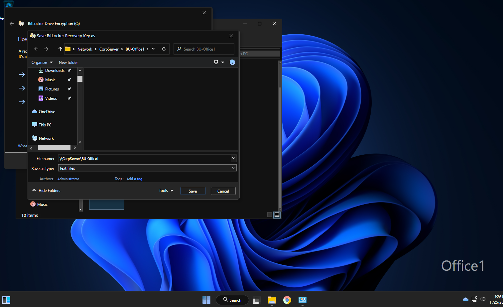
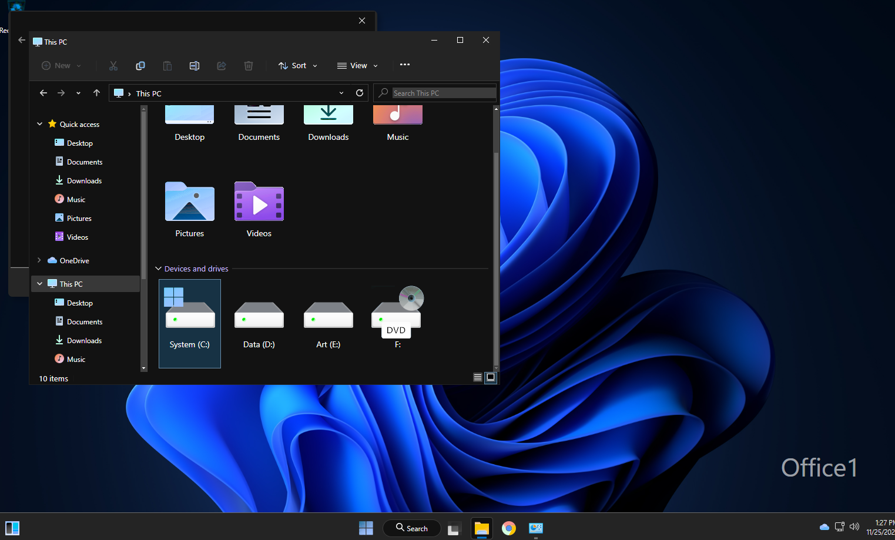
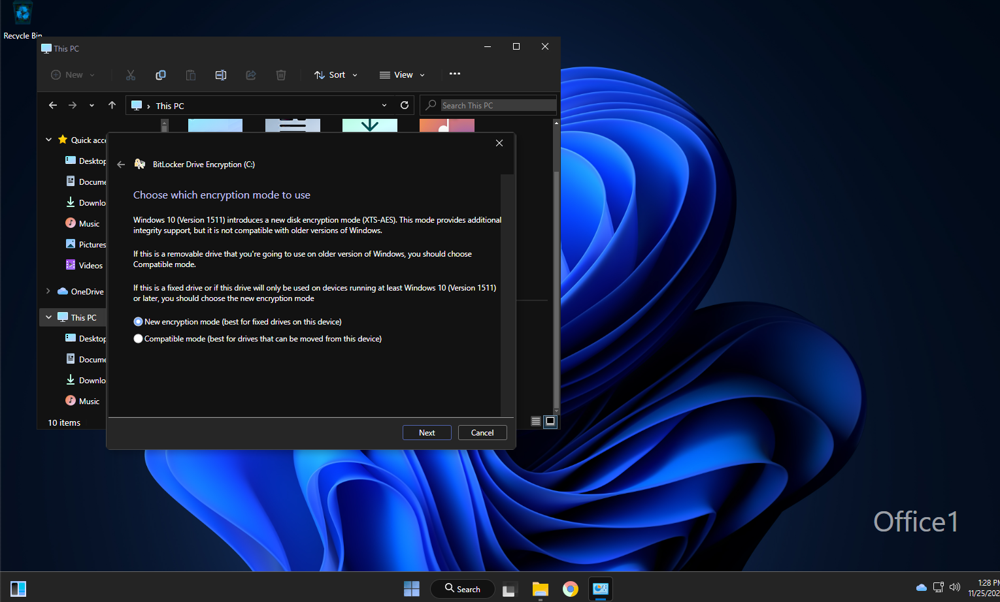
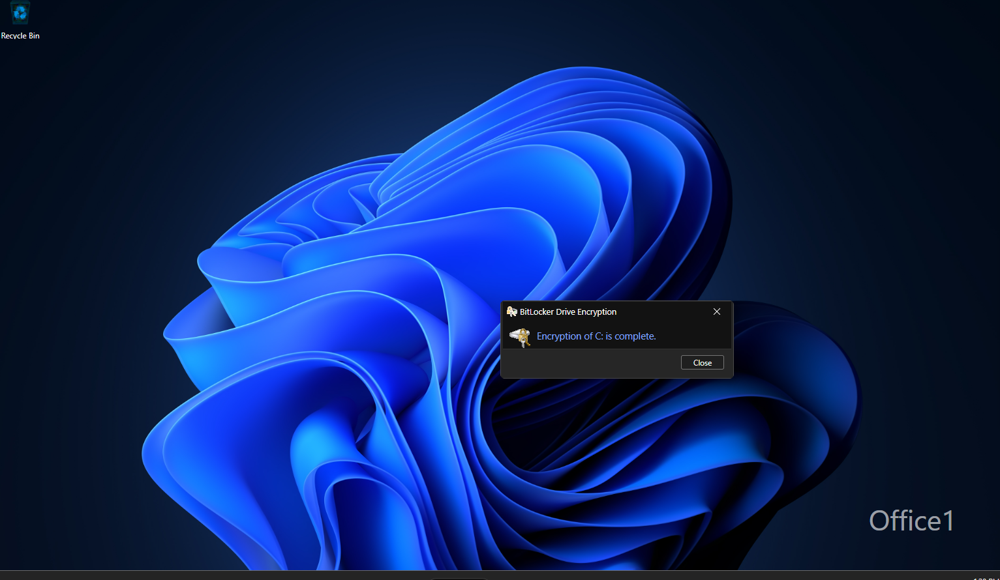

# BitLocker Drive Encryption

A CompTIA Security+ course lab (3.2.3, Configure BitLocker with a TPM) completed in a simulated Windows environment. I turned on BitLocker for the System (C:) drive, backed up the recovery key to a network folder, and encrypted the entire volume with the new encryption mode.

## Summary

Acting as the IT security administrator for a small corporate network, I was asked to encrypt the System volume on the Office1 computer so that a stolen hard drive would not expose sensitive project data.

In the Office1 virtual machine I opened File Explorer, went to This PC, right-clicked System (C:), and chose Turn on BitLocker. I saved the recovery key to a file in `\\CorpServer\BU-Office1`, chose Encrypt entire drive, selected New encryption mode (XTS-AES, for fixed drives), ran the BitLocker system check, and restarted. After the restart, BitLocker reported "Encryption of C: is complete."

## My Role

I completed this hands-on in CompTIA's lab on November 25, 2026. I configured BitLocker drive encryption on the System (C:) volume in the Office1 lab VM, chose where to store the recovery key, and selected the encryption scope and mode the lab required. Office1, CorpServer, and the BU-Office1 share are part of the course lab, not a real workplace or my own network. The write-up is my own.

## Evidence

### Recovery key backup options

After turning on BitLocker for System (C:), the wizard asked how to back up the recovery key. I chose Save to a file so the key would be stored off the same PC, not only on the drive being encrypted.

### Save dialog opened in Documents

The Save BitLocker Recovery Key as dialog opened in the Documents library. The lab required the key to be saved on `\\CorpServer\BU-Office1`, not in the local Documents folder.

### Recovery key saved to \\CorpServer\BU-Office1

I navigated the save dialog to the `\\CorpServer\BU-Office1` network folder, which appears in the address bar as Network > CorpServer > BU-Office1, and saved the recovery key there.

### This PC, System (C:) and other drives

File Explorer on This PC shows the Office1 volumes, including System (C:), the drive I encrypted. During the wizard, this window was in front of the BitLocker dialog.

### New encryption mode (XTS-AES)

I selected New encryption mode, which uses XTS-AES. The wizard states this mode is best for fixed drives on this device. Compatible mode is for removable drives that might be used on older versions of Windows.

### Encryption of C: complete

After I ran the BitLocker system check and restarted, BitLocker reported that encryption of C: was complete.

## Skills Demonstrated

- Turning on BitLocker for the Windows System (C:) volume
- Backing up a BitLocker recovery key to a network share instead of the same PC
- Choosing to encrypt the entire drive, not used space only
- Selecting new encryption mode (XTS-AES) for a fixed system drive
- Running the BitLocker system check and completing encryption after a restart

## Key Concepts

- Full disk encryption (FDE) protects data at rest. If the hard drive is stolen, the contents stay unreadable without the key or a successful TPM unlock.
- A TPM (Trusted Platform Module) can hold the BitLocker protector and release it only when the system starts in a trusted state, so a standard system-drive setup does not prompt for a password at every boot.
- The recovery key is a backup unlock method if the TPM or startup files change, or if the drive is moved to another computer. It should be stored off the encrypted drive, in a safe location such as a network backup share.
- New encryption mode uses XTS-AES and is the right choice for fixed drives on Windows 10 (version 1511) and later. Compatible mode is for removable drives that may be unlocked on older Windows versions.

## Tools Used

- BitLocker Drive Encryption wizard (Windows, course lab environment)
- File Explorer
- Office1 lab virtual machine

## Disclaimer

This is a CompTIA Security+ course lab in a simulated environment. Office1, CorpServer, and the BU-Office1 share are part of the training lab. The screenshots and write-up document my own work in that lab; they do not represent a real production network or employer.
